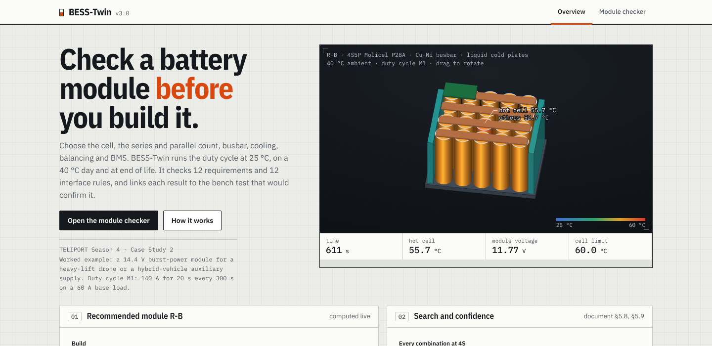
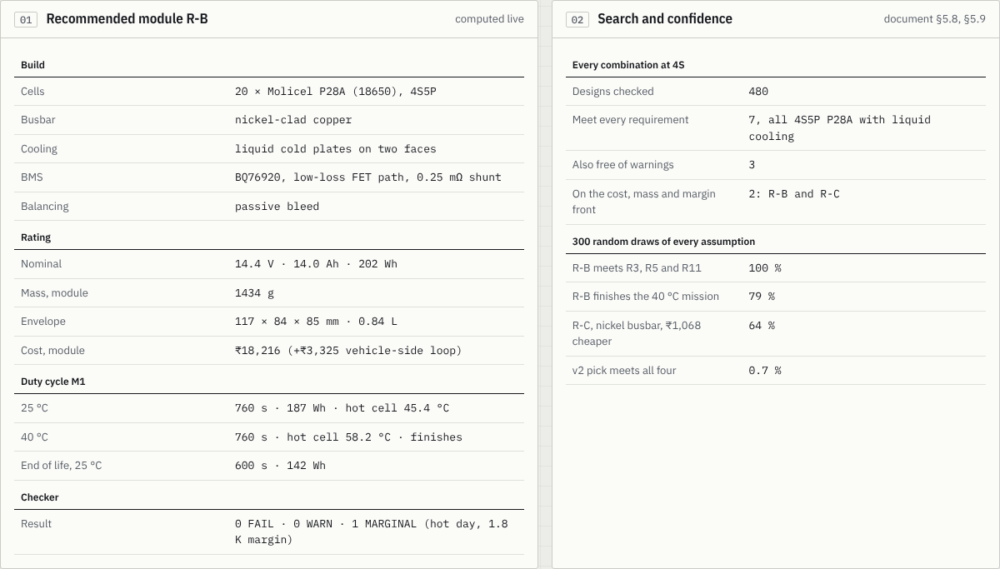
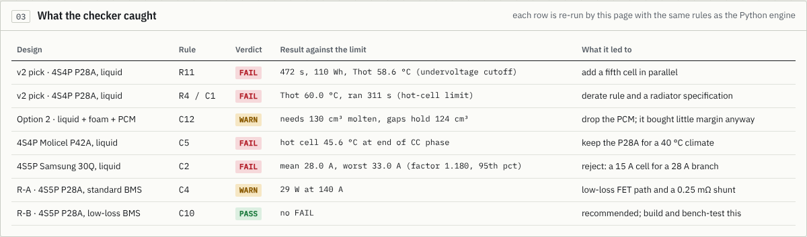
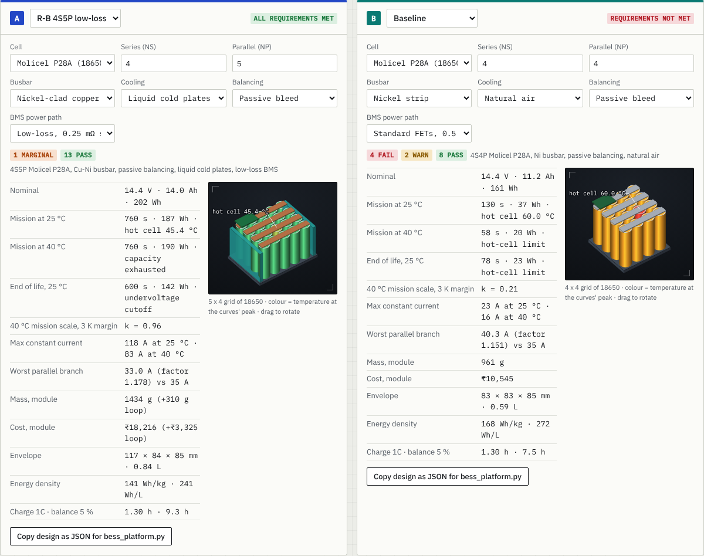
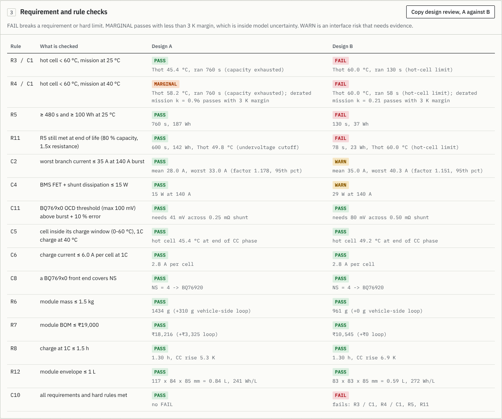
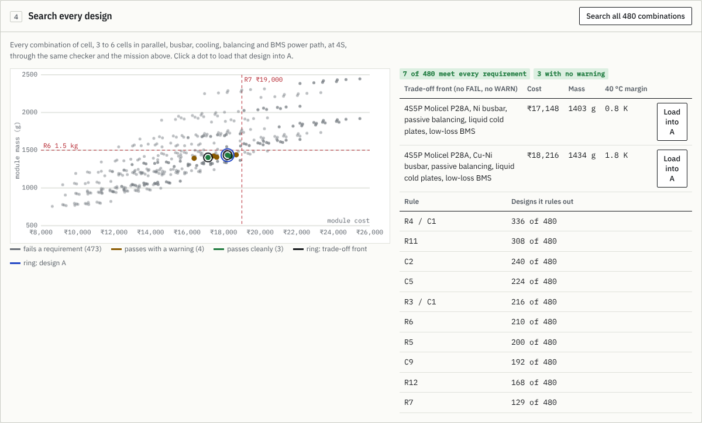
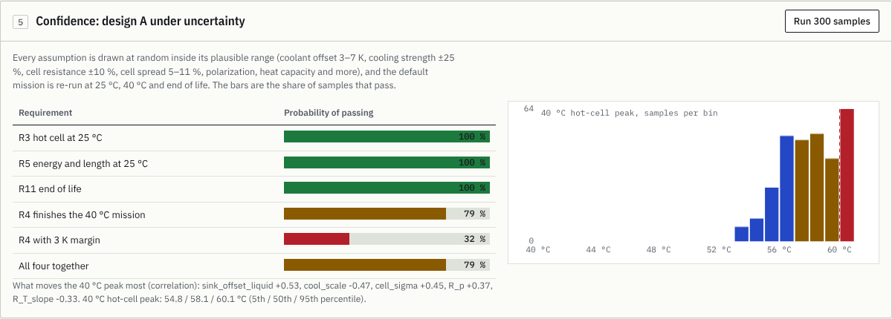
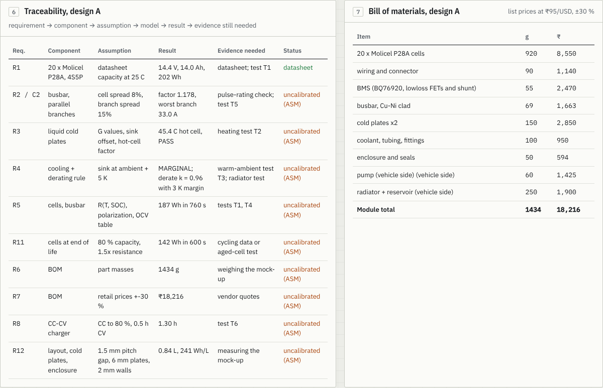

# BESS-Twin

**Check a battery module before you build it.** TELIPORT Season 4, Case Study 2: a reusable digital platform for designing battery energy systems.

**Live demo: https://arthav23.github.io/BESS-Twin/** (one offline HTML file; also in this repo as [`docs/index.html`](docs/index.html))

> **Status, stated plainly.** Every result here is simulated, or checked against published P28A data. The bench tests in [`bench/`](bench/BENCH_TEST_GUIDE.md) and the user interviews in [`INTERVIEW_KIT.md`](INTERVIEW_KIT.md) are **not run yet**. Values that rest on an assumption keep their `ASM` tag until they are measured.



BESS-Twin puts the data that normally lives in separate spreadsheets (cell datasheet, thermal estimate, BMS datasheet, CAD sketch, price list) into **one tagged parameter set**. That set feeds electrical, thermal, cell-variation, end-of-life, protection, balancing, geometry and cost models. A checker then judges **12 requirements and 12 interface rules**, and every result is traced to the requirement, assumption, model and bench test behind it.

Worked example: a 14.4 V burst-power module of Molicel P28A cells for a heavy-lift drone or a hybrid-vehicle auxiliary supply (140 A for 20 s every 300 s on a 60 A base load).

---

## The demonstration

The dashboard has two pages. Everything below is computed live in the browser by the same equations as the Python engine.

**Overview.** The recommended module in 3D (drag to rotate), cells coloured by temperature as a 40 °C mission plays back, with a live datasheet table, the search and confidence figures, and a log of what the checker caught.





**Module checker.** Two designs side by side. Change the cell, series and parallel count, busbar, cooling, balancing, BMS and the duty cycle, and every number, rule and 3D view updates in about 0.25 s.





**Search and confidence.** All 480 combinations in about 2 s, then 300 random draws of every assumption.





**Traceability and bill of materials.**



---

## Evaluation criteria, end to end

| Criterion | Weight | What it asks | Where to look | Still open |
|---|---|---|---|---|
| [Problem understanding](#1-problem-understanding-15) | 15 % | Clear application, scope, requirements | Design doc §2, overview page | Mission and limits R4–R8, R11, R12 are our assumptions |
| [Desirability](#2-desirability-15) | 15 % | Value to a user, relevance | Design doc §3.3, §10, `INTERVIEW_KIT.md` | No interviews or usability sessions yet |
| [Technical feasibility](#3-technical-feasibility-20) | 20 % | Simple, safe, achievable with the time, data and resources | `bess_platform.py`, `bench/`, design doc §8, §9 | Logger firmware untested on hardware |
| [Engineering quality](#4-engineering-quality-15) | 15 % | Sound calculations, assumptions, system interactions | Design doc §4, §6, §7, checker log | Lumped thermal model |
| [Prototype & evidence](#5-prototype--evidence-15) | 15 % | Working demonstration or model with **measurable and repeatable results** | This page, `reproduce.py`, `results*.json` | No own bench measurement yet |
| [Innovation](#6-innovation-10) | 10 % | Creative but understandable improvement over the starting design | Design doc §5.5–5.9 | Components are known; the workflow is the contribution |
| [Business viability](#7-business-viability-10) | 10 % | Value in cost, performance, safety, usability, scalability | Design doc §10 | Prices are hypotheses |

### 1. Problem understanding (15 %)

- **Application and scope.** One module of 16–20 cells (3 to 15 in series, any parallel count). Full packs, high-voltage isolation, CFD and abuse testing are out of scope, as the brief asks. [Design doc §2](BESS-Twin_Design_Document.md).
- **Duty cycle M1.** 140 A for 20 s at the start of every 300 s on a 60 A base load, run until a limit trips. Run at **25 °C**, on a **40 °C day** and at **end of life** (80 % capacity, 1.5× resistance).
- **Twelve requirements.** Hot cell below 60 °C at 25 °C and 40 °C (R3, R4); at least 100 Wh and 480 s (R5); same at end of life (R11); mass at most 1.5 kg (R6); cost at most ₹19,000 (R7); 1C charge at most 1.5 h (R8); envelope at most 1 L (R12); plus rating, peak current, hardware protection and sensor-fault detection (R1, R2, R9, R10).
- **The challenge in the brief, and the answer.** Data spread across disciplines → one tagged parameter set. Trade-offs between energy, temperature, charge time, safety, size and cost → one checker over all of them. Cell variation and ageing that propagate to the system → a Monte Carlo of current sharing between parallel cells, and an end-of-life run. Limited tools and data → a pure-Python engine and an offline page, with a one-day bench plan on one cell.

### 2. Desirability (15 %)

- **Who.** Student EV, eBAJA and drone teams (no licensed multi-physics tools); early-stage battery and drone engineers (cell, cooling, busbar and BMS decided in separate spreadsheets); reviewers and judges (cannot see why a design was chosen).
- **What they get.** A model that runs in a browser in seconds with every assumption visible; one coupled check across subsystems; a trace from each requirement to its evidence.
- **Mistakes caught before parts are ordered.** In this study alone: a reference design that fails at end of life, a PCM that does not fit between the cells, a cell whose charge window cannot take a 40 °C day, a 15 A cell proposed for a 28 A branch, a BMS power path that dissipates 29 W, a sense resistor that would have defeated the BMS overcurrent range.
- **Open.** No user has tried it yet. [`INTERVIEW_KIT.md`](INTERVIEW_KIT.md) holds the interview script, five timed usability tasks and pricing questions, with proceed/stop rules.

### 3. Technical feasibility (20 %)

- **No licences, no installs.** `bess_platform.py` is pure Python. The dashboard is one HTML file that works offline.
- **Fast.** On the machine used: five designs in about 3 s, the 480-design search in about 14 s in Python (about 2 s in the browser), 300 uncertainty samples in about 25 s in Python (about 2 s in the browser).
- **Achievable validation.** One day, one cell at a time, 5 A or less, with student-lab kit: [`bench/BENCH_TEST_GUIDE.md`](bench/BENCH_TEST_GUIDE.md), an ESP32 + INA226 logger with its own safety relay ([`bench/logger/`](bench/logger/WIRING.md)), and `calibrate.py` to turn the logs into calibrated values.
- **Safe.** The logger opens a relay at 4.25 V, 2.5 V or 60 °C. Bench procedure: fuse, fire-resistant tray, never unattended. The simulation raises warnings only; hardware protection (BQ76920 thresholds, checked by rule C11) is the safety layer. Design doc §8.
- **Affordable.** Recommended module ₹18,216 (+₹3,325 pump and radiator on the vehicle side), within the ₹19,000 limit.

### 4. Engineering quality (15 %)

- **Models.** Electrical (OCV, temperature- and charge-dependent resistance, one polarization branch), thermal (cell node, PCM enthalpy node, coolant sink), cell variation (20,000-draw Monte Carlo per design), end of life, protection, balancing, geometry, mass and cost. Design doc §4, with hand calculations beside each.
- **Every value is tagged** `DS` (datasheet), `ASM` (assumption) or `calibrated`.
- **Interface conflicts found by the checker** (12 rules, C1–C12):

| Rule | Finding |
|---|---|
| R11 | The v2 pick (4S4P, liquid) runs 472 s at end of life against 480 s required |
| R4 | The same design stops at 310 s on a 40 °C day |
| C2 | Worst parallel branch carries 40.7 A against a 35 A rating |
| C12 | 100 g of PCM needs 130 cm³ molten; the gaps between 16 cells hold 124 cm³ |
| C5 | Molicel P42A reaches 45.6 °C during a 1C charge on a 40 °C day against its 45 °C charge limit |
| C2 | Samsung 30Q (15 A cell) would carry 28 A per branch |
| C4 | Standard BMS path dissipates 29 W at 140 A against a 15 W budget |
| C11 | A 1.5 mΩ shunt would need 234 mV; the BQ76920 maximum is 100 mV |

- **Margins are never rounded up.** A hot-cell margin under 3 K is shown as `MARGINAL`, never `PASS`, because it is inside the model's own uncertainty.
- **Self-checks** run on every engine run (design doc §6.3): see the repeatability table below.

### 5. Prototype & evidence (15 %)

*Working demonstration or model with measurable and repeatable results.*

**The demonstration** is the live dashboard and the screenshots above. **The model** is `bess_platform.py`, run from the command line.

#### Measurable: what is measured, for three designs on the same duty cycle

| Indicator | Baseline (4S4P, air) | v2 pick (4S4P, liquid) | **R-B (4S5P, liquid)** |
|---|---|---|---|
| Usable energy at 25 °C | 37 Wh, stops at 130 s (60 °C limit) | 143 Wh, 600 s | **187 Wh, 760 s** |
| Hot-cell peak at 25 °C | 60.0 °C (limit hit) | 51.7 °C | **45.4 °C** |
| 40 °C day | stops at 58 s | stops at 310 s | **finishes 760 s, peak 58.2 °C (MARGINAL)** |
| End of life, 25 °C | 78 s, 23 Wh | 472 s, 110 Wh | **600 s, 142 Wh** |
| Charge time at 1C | 1.30 h | 1.30 h | 1.30 h |
| Mass (module) | 961 g | 1201 g | 1434 g |
| Size | 0.59 L | 0.69 L | 0.84 L, 141 Wh/kg, 241 Wh/L |
| Cost (module) | ₹10,545 | ₹15,960 | ₹18,216 |
| Checker | 4 FAIL, 2 WARN | 2 FAIL, 2 WARN | **0 FAIL, 0 WARN, 1 MARGINAL** |

Energy, temperature, charge time, mass, size and cost are all indicators the brief names. They come from [`results.json`](results.json) and [`results_recommended.json`](results_recommended.json).

#### How sure: probability of passing, 300 random draws of every assumption

| Requirement | v2 pick | R-C (nickel busbar) | **R-B (Cu-Ni busbar)** |
|---|---|---|---|
| R3 hot cell at 25 °C | 99 % | 100 % | **100 %** |
| R5 energy and run time | 99 % | 100 % | **100 %** |
| R11 end of life | 3 % | 100 % | **100 %** |
| R4 finishes the 40 °C mission | 7 % | 64 % | **79 %** |
| All four together | 0.7 % | 64 % | **79 %** |

Only the hot-day verdict is genuinely uncertain. It is driven by the coolant offset, the cooling strength and the cell-to-cell spread, so those are the first things to measure.

#### Repeatable: how to check it yourself

```
python3 reproduce.py            # about 80 s: re-runs every study and compares with the committed files
python3 reproduce.py --quick    # about 30 s: skips the 480-design search and the uncertainty study
```

Output on a clean run (verified):

```
PASS   five reference designs (section 5.2-5.4)
PASS   design-space exploration (5.5)
PASS   recommended candidates (5.6, 5.7)
PASS   model against published P28A data (9.5)
PASS   480-design search (5.8)
PASS   uncertainty study, R-B, 300 samples (5.9)
PASS   browser engine against Python engine
         10 designs, 202 numeric comparisons, largest relative difference 4.38e-4, verdict mismatches 0
ALL RESULTS REPRODUCED
```

| Why the results repeat | Evidence |
|---|---|
| Deterministic engine | Two consecutive runs write byte-identical `results.json` (and tables) |
| Seeded randomness | Monte Carlo seed 1 (20,000 draws per design), uncertainty seed 7 (300 samples). The same generator is implemented in Python and JavaScript, so both give the same numbers |
| Two independent implementations agree | Python and browser engines: 202 numbers within 0.05 % (the largest difference is volume rounded to 1 mL), every verdict identical, and the search and uncertainty study identical |
| Built-in physics checks | Thermal node against its closed-form solution: 41.7432 °C against 41.7424 °C (0.001 K). Time step 0.25 s against 0.05 s: 143.42 Wh against 143.41 Wh. Energy balance: 0.12 Wh residual on 19.05 Wh of losses. 4S8P against 4S4P: 308 Wh against 143 Wh, 36.6 °C against 51.7 °C, as it must be |
| Checked against published data | At 0.56 A the model gives 2.800 Ah; an independent test of four P28A cells measured 2.745–2.787 Ah. With every cell at the manufacturer's **minimum guaranteed** 2.50 Ah, R-B still meets R5 and R11 (167 Wh; 128 Wh at end of life) |
| Calibration method checked | On synthetic bench logs (labelled synthetic, not measurements), `calibrate.py` recovers hidden values: capacity 0.0 %, R25 +1.1 %, R_p −0.5 %, τ −0.7 %, heat capacity +0.1 %, soc_gain −3.7 % |

The comparison with published data also exposed two real model gaps (it loses no capacity at high current, and none in the cold). They are written up in design doc §9.5 and bounded by the worst-case run above. Do not use the model below about 15 °C until T1 and T4 are done.

#### Not yet measured (the honest part)

- No bench measurement of our own. The bench tests are planned for one day on one cell ([`bench/`](bench/BENCH_TEST_GUIDE.md)). When the logs exist, `python3 bench/calibrate.py data/cell1 --out calib.json`, then `python3 bess_platform.py calib.json` (or load `calib.json` in the dashboard) re-tags every dependent result as `calibrated`.
- No user sessions yet.

### 6. Innovation (10 %)

We do not claim liquid cooling, PCM, or active balancing as new. The contribution is the workflow around them:

- **A checker that steers the design.** It rejected the first recommendation, then led us through a cell and layout search to a design that passes everything.
- **Search of all 480 combinations.** Only 7 meet every requirement, all 4S5P P28A with liquid cooling; two sit on the cost, mass and hot-day-margin front.
- **Probability, not just pass or fail.** R-B finishes the hot day 79 % of the time. The copper busbar buys 15 points of that confidence for ₹1,068. The study also ranks which bench test to run first.
- **Ablation.** Taking the PCM out keeps the same 143 Wh and 600 s at 25 °C, costs about 7 K of temperature margin, and saves 123 g and ₹1,425. At 40 °C the 35 °C PCM is already molten, so it does not help there either.
- **One engine in two places,** Python and browser, with a parity test.
- **A loop from bench to model.** Bench logs in, calibrated values out, results re-tagged.

### 7. Business viability (10 %)

- **Cost.** Near zero to run: a static page and a script on the user's laptop. One avoided wrong prototype is ₹10,545–₹20,473 of parts plus days of build and test.
- **Market context** (context, not our addressable market): India's BMS market was about USD 280 million in 2024 and is forecast to reach about USD 700 million by 2029; eBAJA SAEINDIA 2026 ran 90 electric teams, up from 8 when it started. The comparable commercial tool, MATLAB with Simscape Battery, lists at USD 330 + USD 330 per year academically and needs Simulink and Simscape too. PyBaMM is free, so the paid value has to come from the workflow, not the solver. Sources in design doc §12.
- **Offer (hypotheses, not findings).**

| Tier | Who | Price |
|---|---|---|
| Free | students, teaching | ₹0, open source |
| Team | student and research teams | ₹10,000–20,000 / year |
| Start-up seat | battery, drone and EV firms | ₹28,500–57,000 / year |
| Calibration | anyone with cells or logs | ₹25,000 per cell type |

- **Scaling.** The same parameter store handles larger series and parallel counts; new cells are one library entry; the BQ769x0 variant is chosen from the series count. A 96S pack needs isolation and contactor models this version does not have.
- **Open.** Prices are untested. `INTERVIEW_KIT.md` holds the Van Westendorp questions and decision rules.

---

## Case-study key points

| Key point in the brief | Where |
|---|---|
| Manageable scope | Design doc §2.2 |
| Application, requirements, operating conditions | §2.1–2.3 |
| Cells, connections, temperature control, sensing, protection, controls | §4, §8 |
| Datasheets, calculations, simulation, safe low-voltage experiments | §4, §6.3, §9 |
| At least two options against a starting design | §5.1–5.6 (five reference designs, six variants, two finalists) |
| Measured indicators: energy, temperature, charge time, mass, size, cost | §5.2–5.6, table above |
| Assumptions, sources, safety precautions, results, limitations | tags throughout, §8, §11, §12 |
| Prototype or visual demonstration, next step | Dashboard, §5.6, §11 |
| Configure, visualise, analyse, compare | Dashboard, §3 |
| Parameters exchanged between subsystem models | §3.1 |
| Interface conflicts and limit violations | §6, checker log above |
| Traceability | §7, `results*.json`, dashboard |

## Run it

```
python3 bess_platform.py                                   # five reference designs -> results.json
python3 bess_platform.py --config configs/recommended.json # your own designs (JSON)
python3 bess_platform.py --search                          # all 480 combinations
python3 bess_platform.py --config configs/recommended.json --uq "R-B 4S5P low-loss"   # uncertainty
python3 bess_platform.py --evidence                        # model against published P28A data
python3 reproduce.py                                       # re-run everything and compare
node web/test_parity.js                                    # browser engine against Python engine
python3 web/build_dashboard.py                             # rebuild the dashboard after editing web/
```

Open `docs/index.html` (or `bess_dashboard.html`) in any browser. `#checker` opens the module checker directly.

## Layout

| Path | What it is |
|---|---|
| `bess_platform.py` | The engine: models, checker, traceability, search, uncertainty. |
| `reproduce.py` | Re-runs every published study and compares with the committed results. |
| `docs/index.html`, `bess_dashboard.html` | The dashboard, built from `web/`. `docs/` is what GitHub Pages serves. |
| `docs/screenshots/` | The screenshots on this page. |
| `web/` | Dashboard source, JavaScript engine, parity test, build script. |
| `configs/` | Design files for the exploration and the final candidates. |
| `bench/` | Bench test guide, `calibrate.py`, ESP32 logger firmware and wiring, synthetic-data generator. |
| `results*.json`, `*tables*.md` | Output of the runs quoted in the design document. |
| [`BESS-Twin_Design_Document.md`](BESS-Twin_Design_Document.md) | Requirements, models, results, checker, traceability, safety, validation plan, business case, limitations, sources. |
| [`INTERVIEW_KIT.md`](INTERVIEW_KIT.md) | Interview script, timed usability tasks, pricing questions. |

## Limitations

1. The thermal model is lumped. The hot cell comes from a simulated current-sharing spread, not from geometry; the colours in the 3D view show the model's two temperatures (hot cell and the rest), not a per-cell map.
2. Resistance, polarization, heat capacity, PCM data, convection, coolant coupling and the end-of-life factors are assumptions until the bench day. Absolute temperatures may be off by several kelvin; rankings and trends are more reliable than absolute values.
3. The recommended module passes the 40 °C day by 1.8 K, inside model uncertainty, so a derate rule cuts the burst above 55 °C and the radiator must keep coolant within 5 K of ambient (about 17 W/K).
4. Costs are small-quantity list prices converted at ₹95 per US dollar, ±30 %.
5. Safety: this is a design aid, not a certification claim. No ASIL level is claimed. Thermal runaway is not simulated; 60 °C is an ageing and margin limit.

The full list, with risks and next steps, is in design doc §11.

## Deploying

The site is static, one HTML file. GitHub Pages: Settings → Pages → Deploy from a branch → `main` → `/docs`. Vercel: import the repository with no framework and no build command; `vercel.json` sets the output directory to `docs/`.
